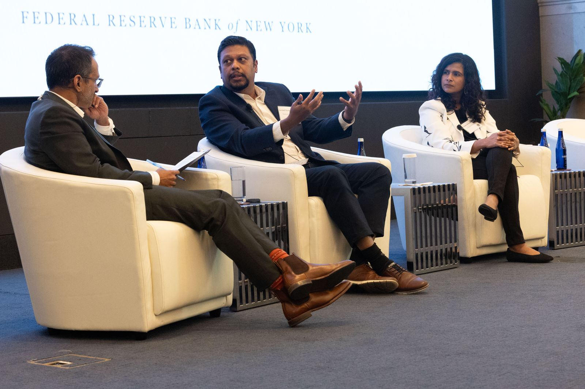
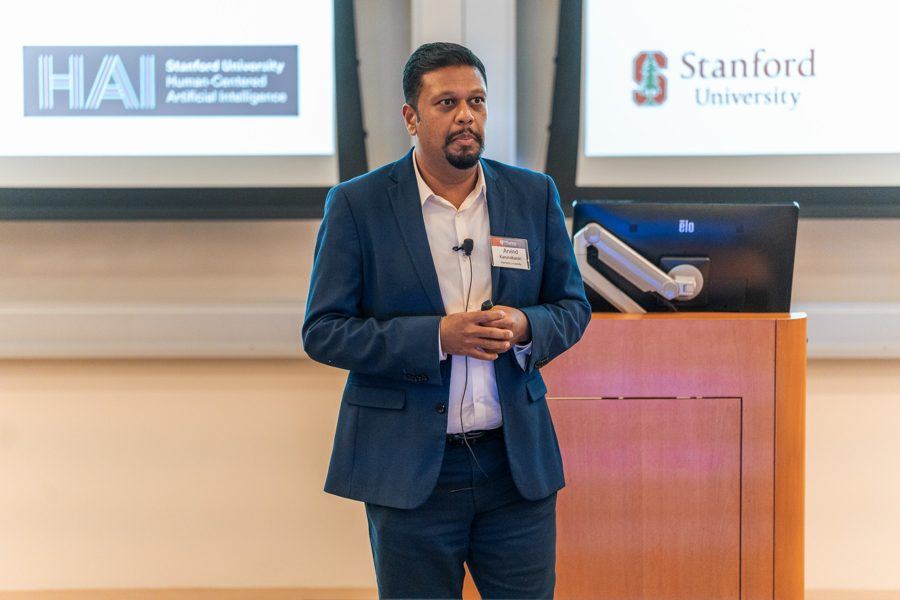
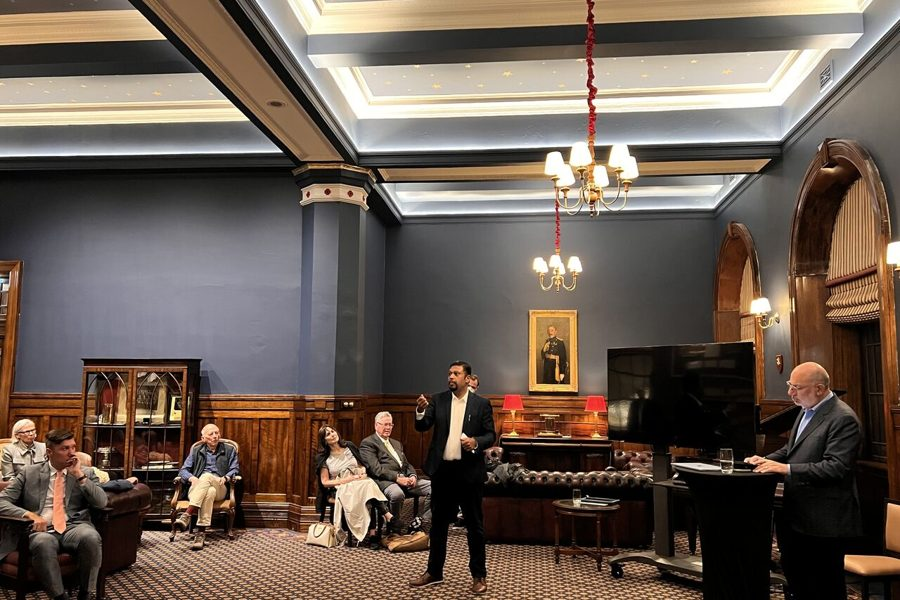
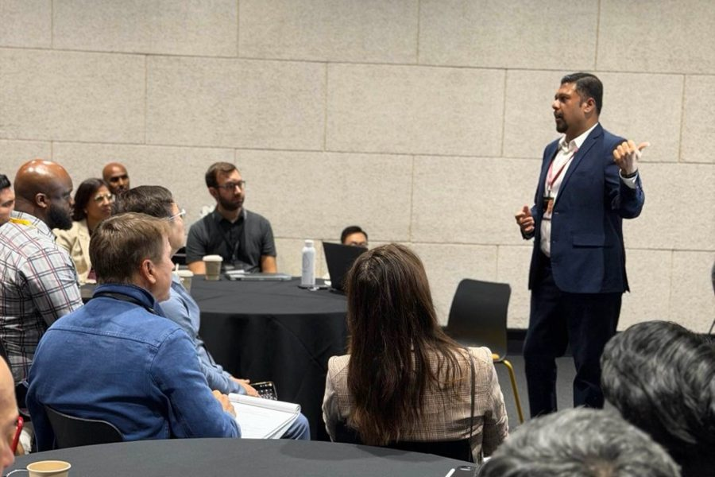
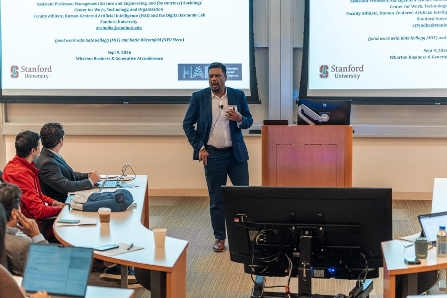
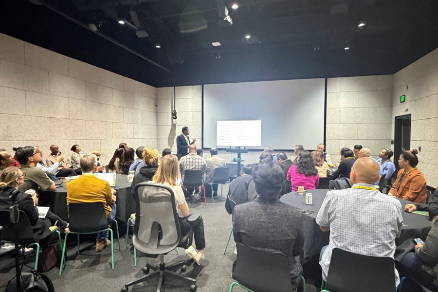
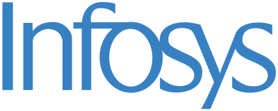

<!--
  Speaking & Advising page. Uses the same article layout, title block, and
  components as the other pages (profile-header, stack-list, eyebrow, booking).
  Page-specific styles live in styles.css under "Speaking & Advising page".
-->

::::: profile-header


:::: profile-intro
::: lede
An evidence-based voice on enterprise AI. Arvind's talks draw on years of
fieldwork inside companies adopting AI, not forecasts, so they focus on what
actually moves value and adoption: strategy, structure, roles, and metrics.
:::

::: profile-affil
Thinkers50 Radar · Faculty affiliate, Stanford HAI and Digital Economy Lab<br>
Research in *ASQ*, *Organization Science*, and *HBR* · Covered by The New York
Times, The Wall Street Journal, the Financial Times, and MSNBC
:::

[Enquire about a talk or session](mailto:arvindka@stanford.edu?subject=Speaking%20inquiry){.btn-doc .no-underline}
::::
:::::

## Sample Talks and Panels

```{=html}
<!--
  SHOW REEL: when the reel is on YouTube or Vimeo, uncomment this block and
  paste the video ID. YouTube: https://www.youtube-nocookie.com/embed/VIDEO_ID
  Vimeo: https://player.vimeo.com/video/VIDEO_ID

<div class="featured-video">
  <div class="video-frame">
    <iframe src="https://www.youtube-nocookie.com/embed/VIDEO_ID" title="Arvind Karunakaran speaker reel" loading="lazy" allow="accelerometer; clipboard-write; encrypted-media; gyroscope; picture-in-picture; web-share" allowfullscreen></iframe>
  </div>
  <p class="video-caption"><strong>Speaker reel</strong> · Highlights from recent keynotes and panels</p>
</div>
-->

<!--
  NY Fed panel, Oct 6, 2026. The recording is the full 3.5-hour conference;
  &t=10599 starts playback at 2:56:39, just before Arvind's first answer.
-->
<div class="lead-talk" id="nyfed-panel">
  <div class="video-frame">
    <iframe src="https://players.brightcove.net/62612260001/ZvrDIQ1n6X_default/index.html?videoId=6406544535112&amp;t=10599" title="AI in the Workplace: Behaviors, Incentives &amp; Inequality, Federal Reserve Bank of New York, October 6, 2026" loading="lazy" allow="encrypted-media; fullscreen; picture-in-picture" allowfullscreen></iframe>
  </div>
  <div class="lead-talk-body">
    
    <div>
      <p class="lead-talk-kicker">Panel · Federal Reserve Bank of New York · October 6, 2026</p>
      <p class="lead-talk-title">AI in the Workplace: Behaviors, Incentives &amp; Inequality</p>
      <p>Governance &amp; Culture Reform Conference. Moderated by Kartik Athreya, Head of Research &amp; Statistics at the New York Fed, with Roshni Raveendhran (UVA Darden).</p>
      <p class="lead-talk-note">The video starts where Arvind begins speaking (2:56:39 in the full conference recording). <a href="https://players.brightcove.net/62612260001/ZvrDIQ1n6X_default/index.html?videoId=6406544535112&amp;t=10599" target="_blank" rel="noopener">Open in a new tab</a> · <a href="https://www.newyorkfed.org/newsevents/events/banking/2026/1006-2026" target="_blank" rel="noopener">Event page</a></p>
    </div>
  </div>
</div>

<!-- IIA-PANEL-START: waiting for the unlisted YouTube link. To switch on,
     replace IIA_VIDEO_ID (3 places) and delete this line and the IIA-PANEL-END line.
     Arvind's turns in the 25-min recording (from frames + audio):
     4:16-5:22, 9:44-11:00, 16:03-17:44, 21:32-22:46, 24:03-24:56.
<div class="lead-talk" id="iia-panel">
  <div class="video-frame">
    <iframe id="iia-player" src="https://www.youtube-nocookie.com/embed/IIA_VIDEO_ID?start=256&amp;rel=0" title="Who Does the Work Now, Imagination in Action AI Summit at Google, September 2026" loading="lazy" allow="accelerometer; clipboard-write; encrypted-media; gyroscope; picture-in-picture; web-share" allowfullscreen></iframe>
  </div>
  <div class="lead-talk-text">
    <p class="lead-talk-kicker">Panel · Imagination in Action AI Summit at Google · September 14, 2026</p>
    <p class="lead-talk-title">Who Does the Work Now</p>
    <p class="lead-talk-note">The video starts at Arvind's first answer. Jump to his other answers:
      <a class="jump" data-start="256" href="https://www.youtube.com/watch?v=IIA_VIDEO_ID&amp;t=256s">4:16</a> ·
      <a class="jump" data-start="584" href="https://www.youtube.com/watch?v=IIA_VIDEO_ID&amp;t=584s">9:44</a> ·
      <a class="jump" data-start="963" href="https://www.youtube.com/watch?v=IIA_VIDEO_ID&amp;t=963s">16:03</a> ·
      <a class="jump" data-start="1292" href="https://www.youtube.com/watch?v=IIA_VIDEO_ID&amp;t=1292s">21:32</a> ·
      <a class="jump" data-start="1443" href="https://www.youtube.com/watch?v=IIA_VIDEO_ID&amp;t=1443s">24:03</a>
    </p>
  </div>
</div>
<script>
// Jump links: restart the embedded player at the chosen second (no YouTube API needed).
document.addEventListener('DOMContentLoaded', function () {
  var player = document.getElementById('iia-player');
  if (!player) return;
  document.querySelectorAll('#iia-panel a.jump').forEach(function (a) {
    a.addEventListener('click', function (e) {
      e.preventDefault();
      player.src = player.src.replace(/start=\d+/, 'start=' + a.getAttribute('data-start')) + (player.src.indexOf('autoplay=1') < 0 ? '&autoplay=1' : '');
      player.scrollIntoView({behavior: 'smooth', block: 'center'});
    });
  });
});
</script>
IIA-PANEL-END -->

<div class="video-grid">
  <a class="video-card" href="https://www.youtube.com/watch?v=KdVAApuFC4w">
    <span class="video-thumb"><i class="bi bi-play-fill" aria-hidden="true"></i></span>
    <span class="video-title">Upskilling vs. Deskilling Spirals in the Wake of Gen AI within Organizations</span>
    <span class="video-src">Talk · AI at Wharton, Business &amp; Generative AI Workshop, San Francisco (20 min)</span>
  </a>
  <a class="video-card" href="https://www.youtube.com/watch?v=orSe5rEKOuo">
    <span class="video-thumb"><i class="bi bi-play-fill" aria-hidden="true"></i></span>
    <span class="video-title">The Future of AI at Work</span>
    <span class="video-src">Podcast · Stanford Engineering, <em>The Future of Everything</em> with Russ Altman (32 min)</span>
  </a>
  <a class="video-card" href="https://www.youtube.com/watch?v=ZByKqo03krQ">
    <span class="video-thumb"><i class="bi bi-play-fill" aria-hidden="true"></i></span>
    <span class="video-title">HAI Seminar: Industry Conversation with Instacart</span>
    <span class="video-src">Seminar · Stanford HAI, with Alexandr Lenk of Instacart (2026)</span>
  </a>
  <a class="video-card" href="https://www.youtube.com/watch?v=U4QWzTPg1gI">
    <span class="video-thumb"><i class="bi bi-play-fill" aria-hidden="true"></i></span>
    <span class="video-title">AI in the Workplace: Rethinking Skill Development</span>
    <span class="video-src">Webinar · Stanford Online (57 min)</span>
  </a>
  <a class="video-card" href="https://www.youtube.com/watch?v=kIZGrqoiGZ8&amp;t=130s">
    <span class="video-thumb"><i class="bi bi-play-fill" aria-hidden="true"></i></span>
    <span class="video-title">Foundation Models in the Workplace</span>
    <span class="video-src">Keynote · Notre Dame–IBM Technology Ethics Lab symposium (24 min)</span>
  </a>
  <a class="video-card" href="https://www.youtube.com/watch?v=d2RIsD0cFi0">
    <span class="video-thumb"><i class="bi bi-play-fill" aria-hidden="true"></i></span>
    <span class="video-title">How ChatGPT and Generative AI Will Shape the Future of Work</span>
    <span class="video-src">Webinar · Stanford Online (26 min)</span>
  </a>
</div>
<p class="video-caption">The Future of AI at Work is also on <a href="https://podcasts.apple.com/us/podcast/the-future-of-ai-at-work/id1235836821?i=1000668622477">Apple Podcasts</a>.</p>

<div class="photo-grid">
  <figure><figcaption>Wharton Business &amp; Generative AI Conference</figcaption></figure>
  <figure><figcaption>Executive briefing, Sydney</figcaption></figure>
  <figure><figcaption>Imagination in Action AI Summit at Google</figcaption></figure>
  <figure><figcaption>Executive workshop</figcaption></figure>
  <figure><figcaption>Wharton Business &amp; Generative AI Conference</figcaption></figure>
  <figure><figcaption>Executive program</figcaption></figure>
</div>
```

## Signature Talks

Every talk can be delivered as a keynote or expanded into a working session,
and each is tailored to the audience and industry.

::: talk-list
1.  **Same Models, Different Results: Where Lasting AI Advantage Comes From**

    Every competitor can buy the same frontier models at the same price, so
    model access alone builds nothing durable. Drawing on multi-year research
    inside enterprises, Arvind shows what does compound: proprietary data,
    encoded enterprise context, and evaluation systems that define "good" in
    your own domain. Leaders leave knowing what to own, where to stay
    deliberately swappable, and which three moves to make next.

    [Best for: CEOs and boards, leadership offsites, strategy summits]{.t-for}

2.  **Escaping Pilot Purgatory: Turning AI Experiments into Enterprise Value**

    Most enterprises now have dozens of AI pilots, yet few have moved the P&L.
    This talk explains why initiatives stall between demo and production
    (unclear ownership, untouched workflows, decision rights no one
    redesigned) and lays out a research-based playbook for scaling:
    build-buy-partner choices, the right operating model, and the
    organizational changes that make AI stick.

    [Best for: Transformation and technology leaders, COOs, internal AI summits]{.t-for}

3.  **Stop Selling AI as a Productivity Tool: How Leaders Get People to Embrace AI**

    In a study of nearly two years inside a law firm, two near-identical teams
    received the same AI tool. The team whose manager framed it as a way to
    enrich their jobs, and backed that up with time, training, and new
    metrics, used it 58% more and experimented with it 70% more. Arvind
    explains why productivity framing backfires and what leaders must change
    to get real adoption.

    [Best for: All-hands meetings, HR and people leaders, change programs, association conferences]{.t-for}

4.  **What Is AI Really Worth? Measuring Value, Not Volume**

    Time saved, tokens consumed, and seats licensed are easy to count, and
    they reward the wrong behavior. Arvind shows where claimed productivity
    gains quietly evaporate into downstream rework, why the biggest returns
    come from expanding and reconfiguring work rather than substituting for
    it, and how to build metrics that connect AI to customers, revenue, and
    capacity.

    [Best for: CFOs, finance and operations leaders, boards, customer and investor events]{.t-for}

5.  **Agentic AI in the Enterprise: From Demo to Dependable**

    AI agents demo beautifully, then stall. This talk explains why agentic
    initiatives break at the hand-offs between agents, systems, and the people
    accountable for outcomes, and what separates the firms that scale them:
    orchestration patterns, human-in-the-loop controls, evaluation
    infrastructure, and governance that keeps domain experts engaged rather
    than sidelined.

    [Best for: CIO/CTO forums, technology and operations leaders, AI conferences]{.t-for}

6.  **The Organization Is the Bottleneck: Leading Change in the AI Era**

    AI changes who holds expertise, who has authority, and whose work gets
    valued. That is why initiatives stall even when the technology works.
    Using three lenses (organizational design, power and politics, and
    culture), Arvind helps leaders diagnose the real barriers to adoption and
    redesign roles, hand-offs, and incentives with the people who do the work.

    [Best for: Leadership development programs, HR and change leaders, executive education]{.t-for}
:::

## Formats

::: stack-list
- [Keynote · 45–60 min]{.year}<br>
  A research-based talk for conferences, offsites, and all-hands meetings.
- [Interactive executive session · 90 min]{.year}<br>
  Frameworks and enterprise cases, with discussion built around the group's
  own challenges.
- [Working session · half or full day]{.year}<br>
  The team leaves with something built: a value map, a 12-month roadmap, or a
  maturity diagnosis.
- [Executive program · multi-day]{.year}<br>
  Sessions combined into a program for leadership teams and executive
  education.
:::

In person or virtual. Every engagement is tailored after a short scoping call
with the sponsor.

### Executive session catalog

Sessions most often requested for executive education and in-house programs.

[I. AI strategy & execution]{.eyebrow}

::: stack-list
- **AI Strategy and Execution: From Vision to Enterprise Value.** An
  enterprise-wide framework for managing AI as a strategic asset: the three
  waves of AI (predictive, generative, agentic), build-buy-partner choices,
  escaping "pilot purgatory," and connecting AI to measurable value. Closes
  with a 90-day roadmapping exercise.
- **Leading with AI: Executive Visioning & Roadmapping.** A working session for
  leadership teams on where durable advantage comes from in an AI-driven
  market, followed by a structured visioning and roadmapping exercise on a
  five-stage AI maturity model.
:::

[II. Building & scaling enterprise AI]{.eyebrow}

::: stack-list
- **Enterprise AI to Create Business Value.** A "three lenses" framework
  (strategic design, power and politics, and culture) to structure, scale, and
  redesign work around AI, including machine-in-the-loop workflows and
  operating-model choices.
- **Agentic AI in Enterprises: Adoption, Orchestration & Scaling.** Why agentic
  initiatives stall between pilot and production, and how leaders handle
  orchestration (multi-agent coordination, human-in-the-loop controls,
  evaluation infrastructure) and scaling across functions.
:::

[III. People, work & organizational change]{.eyebrow}

::: stack-list
- **AI, Change Management & Organizational Transformation.** The change
  management behind building in-house AI capability: why internal efforts
  stall, how to design the division of labor across the AI stack, and why to
  reorganize workflows rather than automate isolated tasks.
- **Reskilling, Role Redesign & Human–AI Augmentation.** The "last-mile"
  problem of adoption and a task-first approach to reskilling and role and
  workflow redesign, anchored by a hands-on task-mapping exercise.
:::

[IV. Governance, metrics & value]{.eyebrow}

::: stack-list
- **Organizational Governance, Implementation & Use of AI.** Two frames for
  capturing value (substitution versus pie expansion), governing across the AI
  stack, and navigating the "jagged frontier" of AI capability.
- **Metrics for Measuring Value from AI.** Why input-centric metrics (time
  saved, tokens, lines of code) backfire, and two better anchors: the dollar
  value of higher-value work performed per role, and business-unit capacity
  expansion.
:::

## Selected Clients

Executive sessions for leaders at organizations including:

```{=html}
<div class="logo-wall">
  <div class="logo-cell"></div>
  <div class="logo-cell"></div>
  <div class="logo-cell"></div>
  <div class="logo-cell"></div>
  <div class="logo-cell"></div>
  <div class="logo-cell"></div>
  <div class="logo-cell"></div>
  <div class="logo-cell"></div>
  <div class="logo-cell"></div>
  <div class="logo-cell"></div>
  <div class="logo-cell"></div>
  <div class="logo-cell"></div>
  <div class="logo-cell"></div>
  <div class="logo-cell"></div>
  <div class="logo-cell"></div>
  <div class="logo-cell"></div>
  <div class="logo-cell"></div>
  <div class="logo-cell"></div>
</div>
```

::: stack-list
- [Professional services]{.year}<br>
  McKinsey & Company · Boston Consulting Group · Accenture · PwC · Deloitte · Infosys
- [Financial services]{.year}<br>
  Barclays · Charles Schwab · TIAA · National Australia Bank · Bank of New Zealand
- [Consumer & retail]{.year}<br>
  PepsiCo · Unilever · Walmart · Nike · Henkel
- [Healthcare & life sciences]{.year}<br>
  Novo Nordisk · DaVita · American Heart Association
:::

## Stages & Appearances

Invited talks at The AI Summit New York, the Imagination in Action AI Summit
at Google, the World Economic Forum, the Federal Reserve Bank of New York, the
Wharton Business & Generative AI Conference, Harvard Business School, MIT
Sloan, Columbia Business School, the Institute for Advanced Study (Princeton),
and Stanford HAI.

::: stack-list
- [Dec 9–10, 2026 · Upcoming]{.year}<br>
  [The AI Summit New York](https://newyork.theaisummit.com/speakers/arvind-karunakaran)
- [Oct 6, 2026]{.year}<br>
  [Federal Reserve Bank of New York](https://www.newyorkfed.org/newsevents/events/banking/2026/1006-2026),
  Governance & Culture Reform Conference. Panel: "AI in the Workplace:
  Behaviors, Incentives & Inequality". [Watch the panel](#nyfed-panel)
- [Sept 14, 2026]{.year}<br>
  Imagination in Action AI Summit at Google. Panel: "Who Does the Work Now"
:::

## Press & Writing

::: stack-list
- [Harvard Business Review · Aug 2026]{.year}<br>
  [AI Experiments Need Domain Experts. Here's How to Support Them.](https://hbr.org/2026/08/ai-experiments-need-domain-experts-heres-how-to-support-them)
  With Katherine Kellogg and Batia Wiesenfeld.
- [Stanford HAI · Oct 2026]{.year}<br>
  [Want Employees to Embrace AI? Stop Selling It as a Productivity Tool](https://hai.stanford.edu/news/want-employees-to-embrace-ai-stop-selling-it-as-a-productivity-tool).
  Coverage of Arvind's field study inside a law firm.
- [Thinkers50]{.year}<br>
  [Thinkers50 Radar profile](https://thinkers50.com/biographies/arvind-karunakaran/).
  The global list of management thinkers shaping the future of business.
:::

Research also covered by The New York Times, The Wall Street Journal, The
Washington Post, the Financial Times, and MSNBC.

## Speaker Bio

Arvind Karunakaran is an Assistant Professor of Management Science & Engineering
(and, by courtesy, Sociology) at Stanford University, and a faculty affiliate of
the Stanford Institute for Human-Centered AI (HAI) and the Stanford Digital
Economy Lab. Named to the Thinkers50 Radar, he studies what actually happens
inside organizations when they adopt AI, and why the bottleneck is rarely the
technology. His multi-year field research explains why AI pilots stall between
demo and production, why conventional ROI metrics reward usage instead of value,
and how leaders redesign roles, workflows, and governance so that AI gains
compound.

His work appears in *Administrative Science Quarterly*, *Organization Science*,
*Research Policy*, and *Harvard Business Review*, and has been covered by The New
York Times, The Wall Street Journal, the Financial Times, and MSNBC. He has led
executive sessions for leaders at McKinsey, BCG, Accenture, Walmart, PepsiCo,
Nike, Barclays, Charles Schwab, and Novo Nordisk. A computer science engineer by
training with prior work experience in the technology and consulting industries,
he holds a master's in Information Science and Technology from Penn State and a
PhD in Management (Information Technology and Organizations) from the MIT Sloan
School of Management.

```{=html}
<div class="bio-extras">
<details>
  <summary>Short bio for programs and listings</summary>
  <p>Arvind Karunakaran is an assistant professor at Stanford University and a faculty affiliate of the Stanford Institute for Human-Centered AI (HAI). Named to the Thinkers50 Radar, he draws on multi-year field research inside companies to show leaders why most AI initiatives stall before they reach the P&amp;L, and what it takes in strategy, structure, roles, and metrics to turn AI into lasting value. He received his PhD from the MIT Sloan School of Management.</p>
</details>
<details>
  <summary>Introduction for an emcee to read aloud</summary>
  <p>“Our next speaker studies what really happens when companies bring AI into the workplace: not in the lab, but inside the teams that have to make it work. Arvind Karunakaran is on the faculty of Stanford University in Management Science and Engineering, and is a faculty affiliate of Stanford’s Institute for Human-Centered AI. He was named to the Thinkers50 Radar, the global list of management thinkers shaping the future of business. His research has been published in Harvard Business Review and covered by The New York Times and The Wall Street Journal, and he works with leadership teams at organizations from McKinsey and Accenture to Nike and PepsiCo. Please join me in welcoming Arvind Karunakaran.”</p>
</details>
</div>
```

High-resolution headshots and event photos are available on request.

## Startup Advising

Arvind advises early-stage startups as a technical and strategic advisor,
helping founders make sound product, go-to-market, and organizational decisions
as they build and scale.

::: stack-list
- **AI.** Where AI creates durable advantage, and how to build products and
  capabilities around it rather than bolting it on.
- **Agentic governance.** Oversight, accountability, human-in-the-loop
  controls, and evaluation for AI agents that act with increasing autonomy.
- **Deployment.** Moving from prototype to production: architecture,
  integration with existing workflows, and the operating model needed to run
  AI reliably.
- **Adoption.** Why users and organizations resist or underuse new technology,
  and how to design for trust, training, and workflow change.
- **ROI.** Measuring the value of AI beyond usage metrics, and tying it to
  cost, revenue, and capacity outcomes.
- **Platforms and two-sided markets.** Network effects, pricing, governance,
  and balancing the needs of both sides of a market.
:::

::: booking
**Interested in a keynote, executive session, workshop, or advisory
engagement?** Email [arvindka@stanford.edu](mailto:arvindka@stanford.edu?subject=Speaking%20inquiry)
with the date, location, audience, and format you have in mind.
:::
