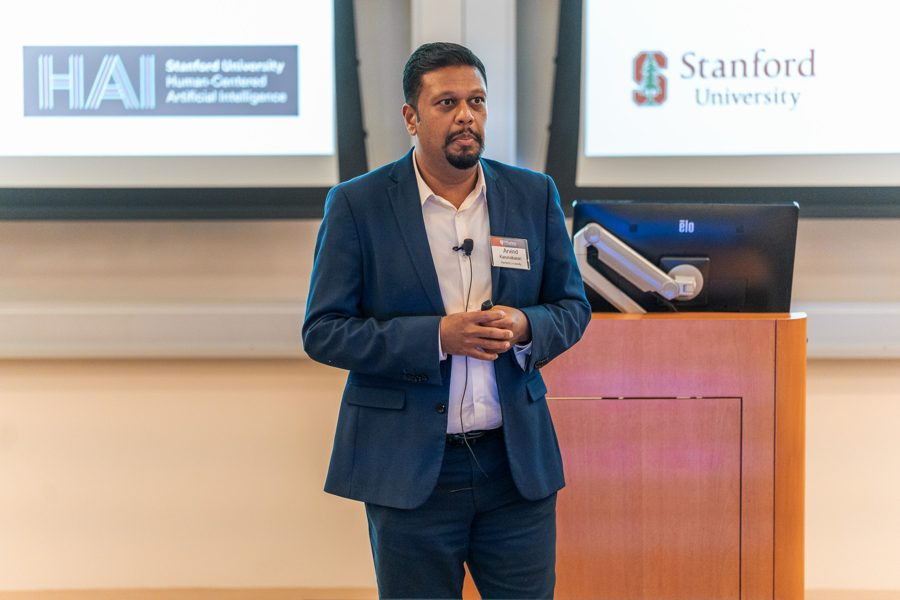
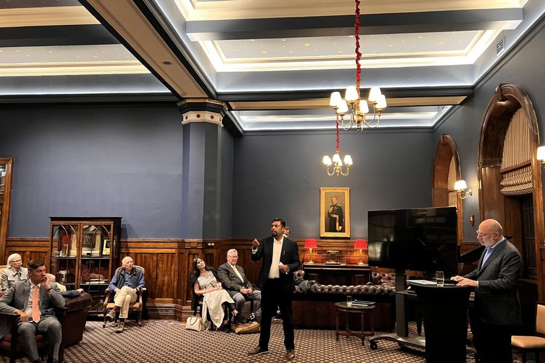
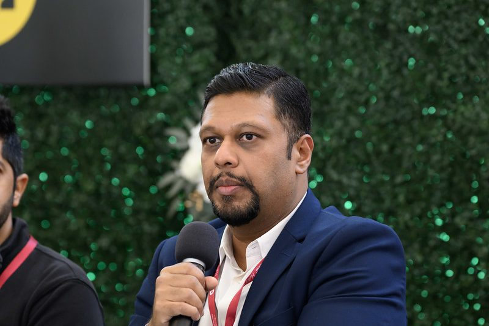
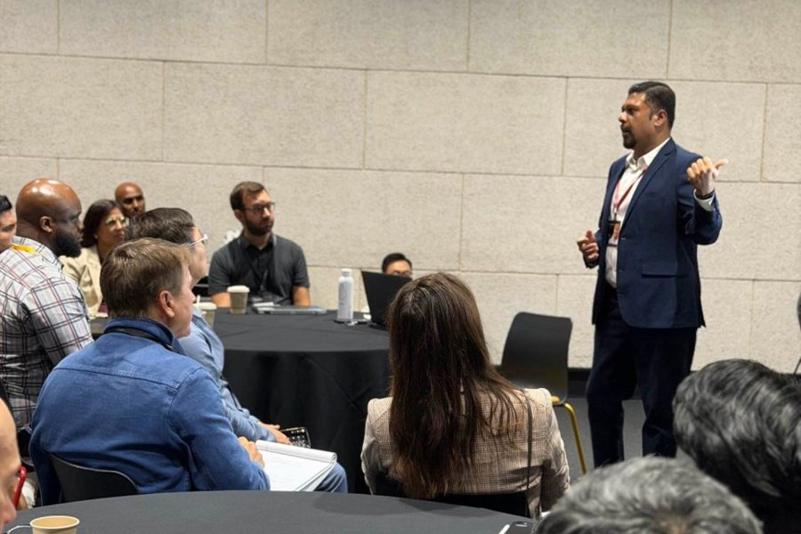
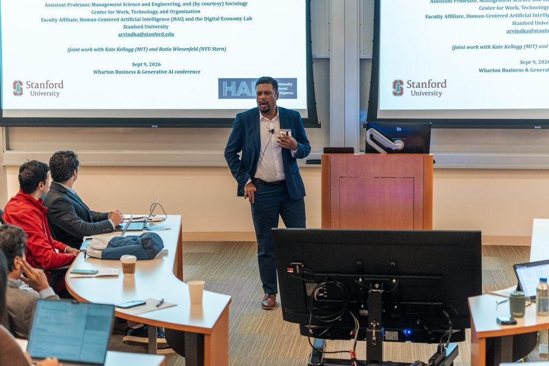
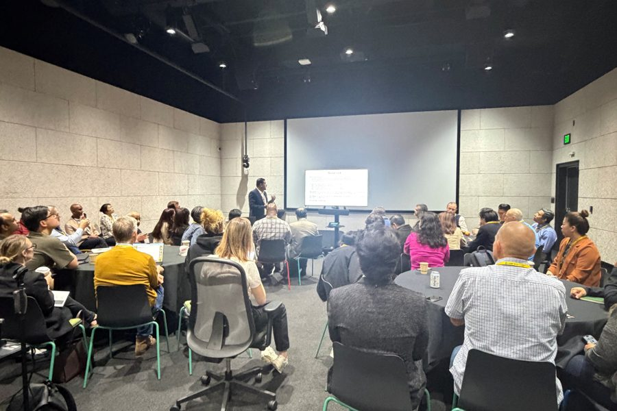

<!--
  Speaking & Advising page.
  Layout: page-layout: custom (no Quarto grid). Each band is a full-width
  section; .sp-wrap caps the inner width. Styles live in styles.css under
  "Speaking & Advising page".
-->

```{=html}
<section class="sp-hero" aria-labelledby="sp-hero-title">
  <div class="sp-hero-text">
    <p class="sp-eyebrow">Keynotes · Executive sessions · Advising</p>
    <h1 id="sp-hero-title">Why AI pilots stall, and how organizations turn AI into lasting value</h1>
    <p class="sp-hero-lede">Arvind Karunakaran is a Stanford professor and an evidence-based voice on enterprise AI. His talks draw on years of fieldwork inside companies adopting AI, not forecasts, so they focus on what actually moves value and adoption.</p>
    <p class="sp-hero-actions">
      <a class="sp-btn sp-btn-primary" href="mailto:arvindka@stanford.edu?subject=Speaking%20inquiry">Book a talk</a>
      <a class="sp-btn sp-btn-ghost" href="#watch">Watch him speak</a>
    </p>
  </div>
</section>

<section class="sp-proof" aria-label="Credentials">
  <div class="sp-wrap sp-proof-grid">
    <div><strong>Thinkers50 Radar</strong><span>Named among the management thinkers shaping the future of business</span></div>
    <div><strong>Stanford HAI &amp; Digital Economy Lab</strong><span>Faculty affiliate; Management Science &amp; Engineering faculty</span></div>
    <div><strong>ASQ · Organization Science · HBR</strong><span>Where the research is published</span></div>
    <div><strong>NYT · WSJ · FT · MSNBC</strong><span>Where the research has been covered</span></div>
  </div>
</section>

<nav class="sp-subnav" aria-label="On this page">
  <div class="sp-wrap">
    <a href="#talks">Talks</a><a href="#formats">Formats</a><a href="#watch">Watch</a><a href="#clients">Clients</a><a href="#bio">Bio</a><a href="#advising">Advising</a><a href="#book">Book</a>
  </div>
</nav>
```

::::: {.sp-section #talks}
:::: {.sp-wrap}
[Signature talks]{.sp-kicker}

## What leaders get wrong about AI, and what to do instead

::: {.sp-intro}
Every talk can be delivered as a keynote or expanded into a working session,
and each is tailored to the audience and industry.
:::

```{=html}
<div class="talk-grid">
  <article class="talk-card">
    <p class="talk-num">01</p>
    <h3 class="talk-title">Same Models, Different Results: Where Lasting AI Advantage Comes From</h3>
    <p class="talk-desc">Every competitor can buy the same frontier models at the same price, so model access alone builds nothing durable. Drawing on multi-year research inside enterprises, Arvind shows what does compound: proprietary data, encoded enterprise context, and evaluation systems that define “good” in your own domain. Leaders leave knowing what to own, where to stay deliberately swappable, and which three moves to make next.</p>
    <p class="talk-for"><span>Best for</span> CEOs and boards, leadership offsites, strategy summits</p>
  </article>
  <article class="talk-card">
    <p class="talk-num">02</p>
    <h3 class="talk-title">Escaping Pilot Purgatory: Turning AI Experiments into Enterprise Value</h3>
    <p class="talk-desc">Most enterprises now have dozens of AI pilots, yet few have moved the P&amp;L. This talk explains why initiatives stall between demo and production (unclear ownership, untouched workflows, decision rights no one redesigned) and lays out a research-based playbook for scaling: build-buy-partner choices, the right operating model, and the organizational changes that make AI stick.</p>
    <p class="talk-for"><span>Best for</span> Transformation and technology leaders, COOs, internal AI summits</p>
  </article>
  <article class="talk-card">
    <p class="talk-num">03</p>
    <h3 class="talk-title">Stop Selling AI as a Productivity Tool: How Leaders Get People to Embrace AI</h3>
    <p class="talk-desc">In a study of nearly two years inside a law firm, two near-identical teams received the same AI tool. The team whose manager framed it as a way to enrich their jobs, and backed that up with time, training, and new metrics, used it 58% more and experimented with it 70% more. Arvind explains why productivity framing backfires and what leaders must change to get real adoption.</p>
    <p class="talk-for"><span>Best for</span> All-hands meetings, HR and people leaders, change programs, association conferences</p>
  </article>
  <article class="talk-card">
    <p class="talk-num">04</p>
    <h3 class="talk-title">What Is AI Really Worth? Measuring Value, Not Volume</h3>
    <p class="talk-desc">Time saved, tokens consumed, and seats licensed are easy to count, and they reward the wrong behavior. Arvind shows where claimed productivity gains quietly evaporate into downstream rework, why the biggest returns come from expanding and reconfiguring work rather than substituting for it, and how to build metrics that connect AI to customers, revenue, and capacity.</p>
    <p class="talk-for"><span>Best for</span> CFOs, finance and operations leaders, boards, customer and investor events</p>
  </article>
  <article class="talk-card">
    <p class="talk-num">05</p>
    <h3 class="talk-title">Agentic AI in the Enterprise: From Demo to Dependable</h3>
    <p class="talk-desc">AI agents demo beautifully, then stall. This talk explains why agentic initiatives break at the hand-offs between agents, systems, and the people accountable for outcomes, and what separates the firms that scale them: orchestration patterns, human-in-the-loop controls, evaluation infrastructure, and governance that keeps domain experts engaged rather than sidelined.</p>
    <p class="talk-for"><span>Best for</span> CIO/CTO forums, technology and operations leaders, AI conferences</p>
  </article>
  <article class="talk-card">
    <p class="talk-num">06</p>
    <h3 class="talk-title">The Organization Is the Bottleneck: Leading Change in the AI Era</h3>
    <p class="talk-desc">AI changes who holds expertise, who has authority, and whose work gets valued. That is why initiatives stall even when the technology works. Using three lenses (organizational design, power and politics, and culture), Arvind helps leaders diagnose the real barriers to adoption and redesign roles, hand-offs, and incentives with the people who do the work.</p>
    <p class="talk-for"><span>Best for</span> Leadership development programs, HR and change leaders, executive education</p>
  </article>
</div>
```
::::
:::::

::::: {.sp-section .sp-tint #formats}
:::: {.sp-wrap}
[Formats]{.sp-kicker}

## From a keynote to a multi-day program

```{=html}
<div class="format-grid">
  <div class="format-card"><p class="format-len">45–60 min</p><h3>Keynote</h3><p>A research-based talk for conferences, offsites, and all-hands meetings.</p></div>
  <div class="format-card"><p class="format-len">90 min</p><h3>Interactive executive session</h3><p>Frameworks and enterprise cases, with discussion built around the group’s own challenges.</p></div>
  <div class="format-card"><p class="format-len">Half or full day</p><h3>Working session</h3><p>The team leaves with something built: a value map, a 12-month roadmap, or a maturity diagnosis.</p></div>
  <div class="format-card"><p class="format-len">Multi-day</p><h3>Executive program</h3><p>Sessions combined into a program for leadership teams and executive education.</p></div>
</div>
<p class="sp-note">In person or virtual. Every engagement is tailored after a short scoping call with the sponsor.</p>
```

### Executive session catalog

Sessions most often requested for executive education and in-house programs.

```{=html}
<div class="catalog-grid">
  <div class="catalog-theme">
    <p class="catalog-label">I. AI strategy &amp; execution</p>
    <p class="catalog-title">AI Strategy and Execution: From Vision to Enterprise Value</p>
    <p class="catalog-desc">An enterprise-wide framework for managing AI as a strategic asset: the three waves of AI (predictive, generative, agentic), build-buy-partner choices, escaping “pilot purgatory,” and connecting AI to measurable value. Closes with a 90-day roadmapping exercise.</p>
    <p class="catalog-title">Leading with AI: Executive Visioning &amp; Roadmapping</p>
    <p class="catalog-desc">A working session for leadership teams on where durable advantage comes from in an AI-driven market, followed by a structured visioning and roadmapping exercise on a five-stage AI maturity model.</p>
  </div>
  <div class="catalog-theme">
    <p class="catalog-label">II. Building &amp; scaling enterprise AI</p>
    <p class="catalog-title">Enterprise AI to Create Business Value</p>
    <p class="catalog-desc">A “three lenses” framework (strategic design, power and politics, and culture) to structure, scale, and redesign work around AI, including machine-in-the-loop workflows and operating-model choices.</p>
    <p class="catalog-title">Agentic AI in Enterprises: Adoption, Orchestration &amp; Scaling</p>
    <p class="catalog-desc">Why agentic initiatives stall between pilot and production, and how leaders handle orchestration (multi-agent coordination, human-in-the-loop controls, evaluation infrastructure) and scaling across functions.</p>
  </div>
  <div class="catalog-theme">
    <p class="catalog-label">III. People, work &amp; organizational change</p>
    <p class="catalog-title">AI, Change Management &amp; Organizational Transformation</p>
    <p class="catalog-desc">The change management behind building in-house AI capability: why internal efforts stall, how to design the division of labor across the AI stack, and why to reorganize workflows rather than automate isolated tasks.</p>
    <p class="catalog-title">Reskilling, Role Redesign &amp; Human–AI Augmentation</p>
    <p class="catalog-desc">The “last-mile” problem of adoption and a task-first approach to reskilling and role and workflow redesign, anchored by a hands-on task-mapping exercise.</p>
  </div>
  <div class="catalog-theme">
    <p class="catalog-label">IV. Governance, metrics &amp; value</p>
    <p class="catalog-title">Organizational Governance, Implementation &amp; Use of AI</p>
    <p class="catalog-desc">Two frames for capturing value (substitution versus pie expansion), governing across the AI stack, and navigating the “jagged frontier” of AI capability.</p>
    <p class="catalog-title">Metrics for Measuring Value from AI</p>
    <p class="catalog-desc">Why input-centric metrics (time saved, tokens, lines of code) backfire, and two better anchors: the dollar value of higher-value work performed per role, and business-unit capacity expansion.</p>
  </div>
</div>
```
::::
:::::

::::: {.sp-section #watch}
:::: {.sp-wrap}
[Watch &amp; listen]{.sp-kicker}

## See Arvind in action

```{=html}
<!--
  SHOW REEL: when the reel is on YouTube or Vimeo, uncomment this block and
  paste the video ID. YouTube: https://www.youtube-nocookie.com/embed/VIDEO_ID
  Vimeo: https://player.vimeo.com/video/VIDEO_ID

<div class="reel">
  <div class="video-frame">
    <iframe src="https://www.youtube-nocookie.com/embed/VIDEO_ID" title="Arvind Karunakaran speaker reel" loading="lazy" allow="accelerometer; clipboard-write; encrypted-media; gyroscope; picture-in-picture; web-share" allowfullscreen></iframe>
  </div>
  <p class="video-meta"><strong>Speaker reel</strong> · Highlights from recent keynotes and panels</p>
</div>
-->

<div class="featured-video">
  <div class="video-frame">
    <iframe src="https://www.youtube-nocookie.com/embed/KdVAApuFC4w" title="Upskilling vs. Deskilling Spirals in the Wake of Gen AI within Organizations" loading="lazy" allow="accelerometer; clipboard-write; encrypted-media; gyroscope; picture-in-picture; web-share" allowfullscreen></iframe>
  </div>
  <div class="featured-video-text">
    <p class="video-tag">Featured talk · 20 min</p>
    <h3>Upskilling vs. Deskilling Spirals in the Wake of Gen AI within Organizations</h3>
    <p>AI at Wharton, Business &amp; Generative AI Workshop, San Francisco. A short solo talk on why the same AI tools build skills on some teams and erode them on others.</p>
  </div>
</div>

<div class="video-grid">
  <a class="video-card" href="https://www.youtube.com/watch?v=orSe5rEKOuo">
    <span class="video-thumb"><i class="bi bi-play-fill" aria-hidden="true"></i></span>
    <span class="video-tag">Podcast · 32 min</span>
    <span class="video-title">The Future of AI at Work</span>
    <span class="video-src">Stanford Engineering, <em>The Future of Everything</em> with Russ Altman</span>
  </a>
  <a class="video-card" href="https://www.youtube.com/watch?v=ZByKqo03krQ">
    <span class="video-thumb"><i class="bi bi-play-fill" aria-hidden="true"></i></span>
    <span class="video-tag">Seminar · 2026</span>
    <span class="video-title">HAI Seminar: Industry Conversation with Instacart</span>
    <span class="video-src">Stanford HAI, with Alexandr Lenk of Instacart</span>
  </a>
  <a class="video-card" href="https://www.youtube.com/watch?v=U4QWzTPg1gI">
    <span class="video-thumb"><i class="bi bi-play-fill" aria-hidden="true"></i></span>
    <span class="video-tag">Webinar · 57 min</span>
    <span class="video-title">AI in the Workplace: Rethinking Skill Development</span>
    <span class="video-src">Stanford Online</span>
  </a>
  <a class="video-card" href="https://www.youtube.com/watch?v=kIZGrqoiGZ8&amp;t=130s">
    <span class="video-thumb"><i class="bi bi-play-fill" aria-hidden="true"></i></span>
    <span class="video-tag">Keynote · 24 min</span>
    <span class="video-title">Foundation Models in the Workplace</span>
    <span class="video-src">Notre Dame–IBM Technology Ethics Lab symposium</span>
  </a>
  <a class="video-card" href="https://www.youtube.com/watch?v=d2RIsD0cFi0">
    <span class="video-thumb"><i class="bi bi-play-fill" aria-hidden="true"></i></span>
    <span class="video-tag">Webinar · 26 min</span>
    <span class="video-title">How ChatGPT and Generative AI Will Shape the Future of Work</span>
    <span class="video-src">Stanford Online</span>
  </a>
  <a class="video-card video-card-text" href="https://podcasts.apple.com/us/podcast/the-future-of-ai-at-work/id1235836821?i=1000668622477">
    <span class="video-thumb video-thumb-text"><i class="bi bi-mic-fill" aria-hidden="true"></i></span>
    <span class="video-tag">Listen</span>
    <span class="video-title">The Future of AI at Work on Apple Podcasts</span>
    <span class="video-src">The audio edition of the Future of Everything episode</span>
  </a>
</div>
```
::::
:::::

```{=html}
<section class="sp-gallery" aria-label="Photos from recent talks">
  <figure><figcaption>Wharton Business &amp; Generative AI Conference</figcaption></figure>
  <figure><figcaption>Executive briefing, Sydney</figcaption></figure>
  <figure><figcaption>Imagination in Action AI Summit at Google</figcaption></figure>
  <figure><figcaption>Executive workshop</figcaption></figure>
  <figure><figcaption>Wharton Business &amp; Generative AI Conference</figcaption></figure>
  <figure><figcaption>Executive program</figcaption></figure>
</section>
```

::::: {.sp-section #clients}
:::: {.sp-wrap}
[Selected clients]{.sp-kicker}

## Trusted by leadership teams across industries

```{=html}
<div class="logo-wall">
  <div class="logo-cell"></div>
  <div class="logo-cell"></div>
  <div class="logo-cell"></div>
  <div class="logo-cell"></div>
  <div class="logo-cell"></div>
  <div class="logo-cell"></div>
  <div class="logo-cell"></div>
  <div class="logo-cell"></div>
  <div class="logo-cell"></div>
  <div class="logo-cell"></div>
  <div class="logo-cell"></div>
  <div class="logo-cell"></div>
  <div class="logo-cell"></div>
  <div class="logo-cell"></div>
  <div class="logo-cell"></div>
  <div class="logo-cell"></div>
  <div class="logo-cell"></div>
  <div class="logo-cell"></div>
</div>

<dl class="client-industry">
  <div><dt>Professional services</dt><dd>McKinsey &amp; Company · Boston Consulting Group · Accenture · PwC · Deloitte · Infosys</dd></div>
  <div><dt>Financial services</dt><dd>Barclays · Charles Schwab · TIAA · National Australia Bank · Bank of New Zealand</dd></div>
  <div><dt>Consumer &amp; retail</dt><dd>PepsiCo · Unilever · Walmart · Nike · Henkel</dd></div>
  <div><dt>Healthcare &amp; life sciences</dt><dd>Novo Nordisk · DaVita · American Heart Association</dd></div>
</dl>
```

### Selected stages

```{=html}
<ul class="stage-list">
  <li>The AI Summit New York</li>
  <li>Imagination in Action AI Summit at Google</li>
  <li>World Economic Forum</li>
  <li>Federal Reserve Bank of New York</li>
  <li>Wharton Business &amp; Generative AI Conference</li>
  <li>Harvard Business School</li>
  <li>MIT Sloan</li>
  <li>Columbia Business School</li>
  <li>Institute for Advanced Study, Princeton</li>
  <li>Stanford HAI</li>
</ul>

<div class="appearances">
  <div class="appearance">
    <p class="appearance-date">Dec 9–10, 2026 · Upcoming</p>
    <p class="appearance-title"><a href="https://newyork.theaisummit.com/speakers/arvind-karunakaran">The AI Summit New York</a></p>
  </div>
  <div class="appearance">
    <p class="appearance-date">Oct 6, 2026</p>
    <p class="appearance-title"><a href="https://www.newyorkfed.org/newsevents/events/banking/2026/1006-2026">Federal Reserve Bank of New York</a>, Governance &amp; Culture Reform Conference. Panel: “AI in the Workplace: Behaviors, Incentives &amp; Inequality”</p>
  </div>
  <div class="appearance">
    <p class="appearance-date">Sept 14, 2026</p>
    <p class="appearance-title">Imagination in Action AI Summit at Google. Panel: “Who Does the Work Now”</p>
  </div>
</div>
```

### Recent press &amp; writing

```{=html}
<div class="press-grid">
  <a class="press-card" href="https://hbr.org/2026/08/ai-experiments-need-domain-experts-heres-how-to-support-them">
    <span class="press-src">Harvard Business Review · Aug 2026</span>
    <span class="press-title">AI Experiments Need Domain Experts. Here’s How to Support Them.</span>
    <span class="press-note">With Katherine Kellogg and Batia Wiesenfeld</span>
  </a>
  <a class="press-card" href="https://hai.stanford.edu/news/want-employees-to-embrace-ai-stop-selling-it-as-a-productivity-tool">
    <span class="press-src">Stanford HAI · Oct 2026</span>
    <span class="press-title">Want Employees to Embrace AI? Stop Selling It as a Productivity Tool</span>
    <span class="press-note">Coverage of Arvind’s field study inside a law firm</span>
  </a>
  <a class="press-card" href="https://thinkers50.com/biographies/arvind-karunakaran/">
    <span class="press-src">Thinkers50</span>
    <span class="press-title">Thinkers50 Radar profile</span>
    <span class="press-note">The global list of management thinkers shaping the future of business</span>
  </a>
</div>
<p class="sp-note">Research also covered by The New York Times, The Wall Street Journal, The Washington Post, the Financial Times, and MSNBC.</p>
```
::::
:::::

::::: {.sp-section .sp-tint #bio}
:::: {.sp-wrap .bio-grid}
```{=html}
<div class="bio-photo">
  
  <p class="sp-note">High-resolution headshots and event photos are available on request.</p>
</div>
```

::: {.bio-text}
[Speaker bio]{.sp-kicker}

## About Arvind

Arvind Karunakaran is an Assistant Professor of Management Science & Engineering
(and, by courtesy, Sociology) at Stanford University, and a faculty affiliate of
the Stanford Institute for Human-Centered AI (HAI) and the Stanford Digital
Economy Lab. Named to the Thinkers50 Radar, he studies what actually happens
inside organizations when they adopt AI, and why the bottleneck is rarely the
technology. His multi-year field research explains why AI pilots stall between
demo and production, why conventional ROI metrics reward usage instead of value,
and how leaders redesign roles, workflows, and governance so that AI gains
compound.

His work appears in *Administrative Science Quarterly*, *Organization Science*,
*Research Policy*, and *Harvard Business Review*, and has been covered by The New
York Times, The Wall Street Journal, the Financial Times, and MSNBC. He has led
executive sessions for leaders at McKinsey, BCG, Accenture, Walmart, PepsiCo,
Nike, Barclays, Charles Schwab, and Novo Nordisk. A computer science engineer by
training with prior work experience in the technology and consulting industries,
he holds a master’s in Information Science and Technology from Penn State and a
PhD in Management (Information Technology and Organizations) from the MIT Sloan
School of Management.

```{=html}
<div class="bio-extras">
<details>
  <summary>Short bio for programs and listings</summary>
  <p>Arvind Karunakaran is an assistant professor at Stanford University and a faculty affiliate of the Stanford Institute for Human-Centered AI (HAI). Named to the Thinkers50 Radar, he draws on multi-year field research inside companies to show leaders why most AI initiatives stall before they reach the P&amp;L, and what it takes in strategy, structure, roles, and metrics to turn AI into lasting value. He received his PhD from the MIT Sloan School of Management.</p>
</details>

<details>
  <summary>Introduction for an emcee to read aloud</summary>
  <p>“Our next speaker studies what really happens when companies bring AI into the workplace: not in the lab, but inside the teams that have to make it work. Arvind Karunakaran is on the faculty of Stanford University in Management Science and Engineering, and is a faculty affiliate of Stanford’s Institute for Human-Centered AI. He was named to the Thinkers50 Radar, the global list of management thinkers shaping the future of business. His research has been published in Harvard Business Review and covered by The New York Times and The Wall Street Journal, and he works with leadership teams at organizations from McKinsey and Accenture to Nike and PepsiCo. Please join me in welcoming Arvind Karunakaran.”</p>
</details>
</div>
```

:::
::::
:::::

::::: {.sp-section #advising}
:::: {.sp-wrap}
[Startup advising]{.sp-kicker}

## Technical and strategic advisor to early-stage companies

::: {.sp-intro}
Arvind advises founders on product, go-to-market, and organizational decisions
as they build and scale.
:::

```{=html}
<div class="advise-grid">
  <div><h3>AI</h3><p>Where AI creates durable advantage, and how to build products and capabilities around it rather than bolting it on.</p></div>
  <div><h3>Agentic governance</h3><p>Oversight, accountability, human-in-the-loop controls, and evaluation for AI agents that act with increasing autonomy.</p></div>
  <div><h3>Deployment</h3><p>Moving from prototype to production: architecture, integration with existing workflows, and the operating model needed to run AI reliably.</p></div>
  <div><h3>Adoption</h3><p>Why users and organizations resist or underuse new technology, and how to design for trust, training, and workflow change.</p></div>
  <div><h3>ROI</h3><p>Measuring the value of AI beyond usage metrics, and tying it to cost, revenue, and capacity outcomes.</p></div>
  <div><h3>Platforms and two-sided markets</h3><p>Network effects, pricing, governance, and balancing the needs of both sides of a market.</p></div>
</div>
```
::::
:::::

```{=html}
<section class="sp-book" id="book">
  <div class="sp-wrap sp-book-inner">
    <div>
      <p class="sp-kicker sp-kicker-light">Book Arvind</p>
      <h2>Bring the research to your leadership team</h2>
      <p>For keynotes, executive sessions, workshops, and advisory engagements, email Arvind directly. It helps to include the date, location, audience, and format you have in mind.</p>
    </div>
    <p class="sp-book-actions">
      <a class="sp-btn sp-btn-light" href="mailto:arvindka@stanford.edu?subject=Speaking%20inquiry">arvindka@stanford.edu</a>
    </p>
  </div>
</section>
```
